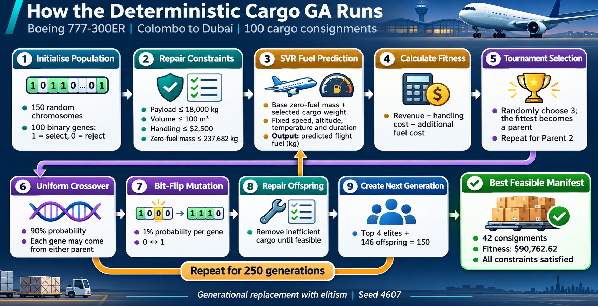

# Stage One: Deterministic Genetic Algorithm

## Objective

The deterministic GA selects a profitable, feasible subset of the 100 CMB–DXB cargo consignments. All consignment values are treated as fixed in Stage One. Availability uncertainty is deliberately reserved for Stage Two so that the chromosome, constraints, SVR connection and fitness calculation can first be verified in a stable environment.



## Fixed flight scenario

| Parameter | Stage-one value |
|---|---:|
| Base zero-fuel mass before selectable cargo | 210,000 kg |
| Available selectable cargo payload | 18,000 kg |
| Available cargo volume | 100 m³ |
| Handling-cost budget | $2,500 |
| Maximum zero-fuel mass | 237,682 kg |
| Cruise speed | 477 kt |
| Cruise altitude | 36,000 ft |
| Temperature deviation | 2 K |
| Flight duration | 239.5 minutes |
| Fuel price | $0.80/kg |

The base mass and fixed operating values lie inside the SVR training ranges. Even at the full 18,000 kg payload limit, the SVR zero-fuel-mass input remains inside its learned range. Payload, volume and handling budget are transparent Stage-One modelling limits rather than claimed Emirates operational figures; they can be subjected to sensitivity testing later.

## GA methodology

The chromosome contains 100 binary genes, one per consignment. A value of `1` selects the consignment and `0` rejects it. The initial population contains 150 chromosomes. Tournament selection, uniform crossover, bit-flip mutation and four-solution elitism are applied for 250 generations. Mutation probability is `0.01` per gene, equivalent to one expected bit mutation per 100-gene chromosome.

After chromosome creation, a repair function checks weight, volume, handling budget and maximum zero-fuel mass. When a violation occurs, it removes the selected consignment with the lowest net value relative to its combined use of constrained resources. This continues until the chromosome is feasible.

For every repaired chromosome, selected cargo weight is added to the base zero-fuel mass. The resulting mass and fixed operating conditions are passed to the saved SVR in a batch prediction. Additional cargo fuel is calculated relative to an otherwise identical no-selected-cargo prediction:

```text
additional fuel = predicted loaded fuel − predicted baseline fuel
fitness = cargo revenue − handling cost − additional fuel cost
```

## Results

| Result | Value |
|---|---:|
| Selected consignments | 42 |
| Selected weight | 15,044.4 kg |
| Selected volume | 97.212 m³ |
| Cargo revenue | $94,511.14 |
| Handling cost | $2,493.97 |
| Baseline fuel prediction | 40,826.57 kg |
| Loaded fuel prediction | 42,394.75 kg |
| Additional fuel | 1,568.18 kg |
| Additional fuel cost | $1,254.55 |
| Final fitness | $90,762.62 |
| Payload utilisation | 83.58% |
| Volume utilisation | 97.21% |
| Handling-budget utilisation | 99.76% |

The resulting zero-fuel mass is 225,044.4 kg, below the 237,682 kg maximum and inside the SVR training range.

## Verification and baselines

| Method | Best fitness |
|---|---:|
| Deterministic GA | $90,762.62 |
| Greedy baseline | $87,545.92 |
| Random baseline (10,000 repaired samples) | $78,119.79 |

The GA improved on the greedy baseline by $3,216.70 and the random baseline by $12,642.83. Best population fitness increased from $68,142.02 at generation zero to $90,762.62. Independent checks confirmed that the saved manifest totals match the summary and satisfy every implemented constraint. Repeating the complete run with seed `4607` produced an identical output file hash, confirming reproducibility.

These results demonstrate performance for one controlled scenario, not universal optimality. Later evaluation should repeat the GA under multiple random seeds and alternative capacity assumptions. Stage Two will then introduce availability scenarios and compare deterministic planned profit with risk-aware performance.
